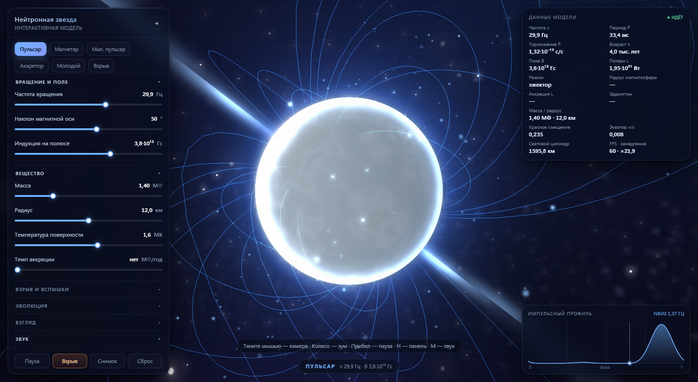

# Нейтронная звезда — интерактивная симуляция

Браузерная 3D-модель нейтронной звезды: пульсар, магнетар, миллисекундный пульсар,
аккретор — и сверхновая с коллапсом в чёрную дыру. Вращается, светит конусами вдоль
магнитной оси, гнёт силовые линии, обрастает аккреционным диском и джетами.

**Запуск:** открыть `index.html` двойным щелчком. Сервер, сборка и установка не нужны —
обычные HTML/CSS/JS, всё работает прямо с диска (`file://`).

## Что внутри

| Файл | Назначение |
|---|---|
| `index.html` | разметка: холст, панель управления, HUD, профиль импульса |
| `styles.css` | оформление интерфейса (тёмное стекло, секции-аккордеон, адаптив) |
| `js/shaders.js` | GLSL: кора звезды, корона, конусы, диск, джеты, ударная волна, фон, bloom |
| `js/glx.js` | обвязка WebGL: контекст, программы, буферы, цели рендера, текстура неба |
| `js/physics.js` | физика (СИ): торможение, магнитосфера, режимы аккреции, красное смещение |
| `js/audio.js` | синтез звука: пэд, FM-колокол, шум аккреции, реверб, взрыв |
| `js/ui.js` | меню управления, строится из схемы параметров |
| `js/app.js` | сцена, камера, силовые линии, частицы, постобработка, HUD, взрыв |
| `preview.png` | скриншот вида по умолчанию |

## Управление

* **Мышь** — вращение камеры, **колесо** — масштаб, **двойной щелчок** — вернуть вид.
* **Пробел** — пауза, **H** — панель, **M** — звук, **E** — взрыв, **R** — сброс,
  **1…6** — сценарии.
* Сценарии: Пульсар (крабоподобный), Магнетар, Миллисекундный пульсар, Аккретор,
  Молодой, Взрыв.

Панель разбита на секции-аккордеоны: «Вращение и поле», «Вещество», «Взрыв и вспышки»,
«Эволюция», «Взгляд», «Звук».

## Что можно исследовать

* **Вращение** 0,05…1500 Гц, наклон магнитной оси 0…90°, поле 10⁸…10¹⁵ Гс.
* **Наклон 0°** — конус не пересекает луч зрения, пульсар «молчит»: профиль импульса
  вырождается в прямую.
* **Аккреция** — диск, раскрутка, режим считается по радиусу Альвена: эжектор →
  пропеллер → аккреция на полюса → прямая аккреция. Виден предел Эддингтона.
* **Эволюция** — «лет в секунду»: звезда тормозится, у магнетаров затухает поле,
  ползунки и HUD обновляются сами.
* **Взрыв** — ударная волна расходится, светит вспышка, летят осколки; можно включить
  коллапс остатка в чёрную дыру (фотонное кольцо, гаснущие силовые линии).
* **Джеты** вдоль оси вращения — для аккретора и магнетара.

## Физика

Всё считается в СИ, в HUD выводятся реальные величины:

* магнитодипольные потери `L = (2π/3)·B²R⁶ω⁴sin²α / (μ0c³)`, торможение из `I·ω·ω̇ = −L`;
* период `Ṗ = −2π·ω̇/ω²`, характерный возраст `τ = P/(2Ṗ)`;
* компактность `Rs/R`, красное смещение `z = 1/√(1−Rs/R) − 1` (оно же смещает цвет
  поверхности в длинноволновую сторону);
* экваториальная скорость `v = ωR` в долях `c` и доплеровское усиление приближающегося края;
* радиус светового цилиндра `c/ω`, радиус совместного вращения, предел разрыва;
* магнитный момент `μ = B R³` и радиус Альвена `R_m = (μ⁴/2GMṀ²)^(1/7)`;
* режим аккреции, равновесный период Гоша–Лэмба, светимость `GMṀ/R` и доля Эддингтона;
* «линия смерти» радиопульсаров по `B/P²`, энергия связи и средняя плотность;
* предупреждение о неустойчивой конфигурации (`R < 1.6 Rs` или `M > 2.25 M☉`);
* энергия взрыва, масса выброса и скорость оболочки `v = √(2E/M_ej)`.

**Вращение для наглядности замедлено** — реальный период миллисекунды, на экране доли
секунды; коэффициент замедления показан в HUD.

## Звук

Полностью синтезируется, без аудиофайлов. Гармоническая подложка (пентатоника, тоника
следует за частотой вращения), ритм импульсов — удар с FM-колоколом и щелчком приёмника,
шум аккреции, шипение магнетара, вспышки и большой «бум» сверхновой. Всё идёт через
компрессор и свёрточный реверб (импульсный отклик генерируется на месте).

Отдельные регуляторы: общая громкость, фон и гул, ритм импульсов, реверберация.
Включается галочкой (браузер требует жест) или клавишей **M**.

## Нагрузка на компьютер

* вся визуализация на GPU; процессор готовит ~1500 вершин линий и до 420 частиц;
* bloom считается в половинном и четвертном разрешении — это дешёвые проходы;
* качество «Авто» следит за FPS и снижает разрешение, если кадры проседают;
* жёсткий бюджет пикселей (1,6–4,2 млн) — кадр не раздувается даже на 4K;
* в неактивной вкладке рендер останавливается, звук уходит в паузу.

Если хочется минимальной нагрузки: «Низкое» качество, плотность частиц в ноль,
свечение и bloom пониже, панель свернуть.
